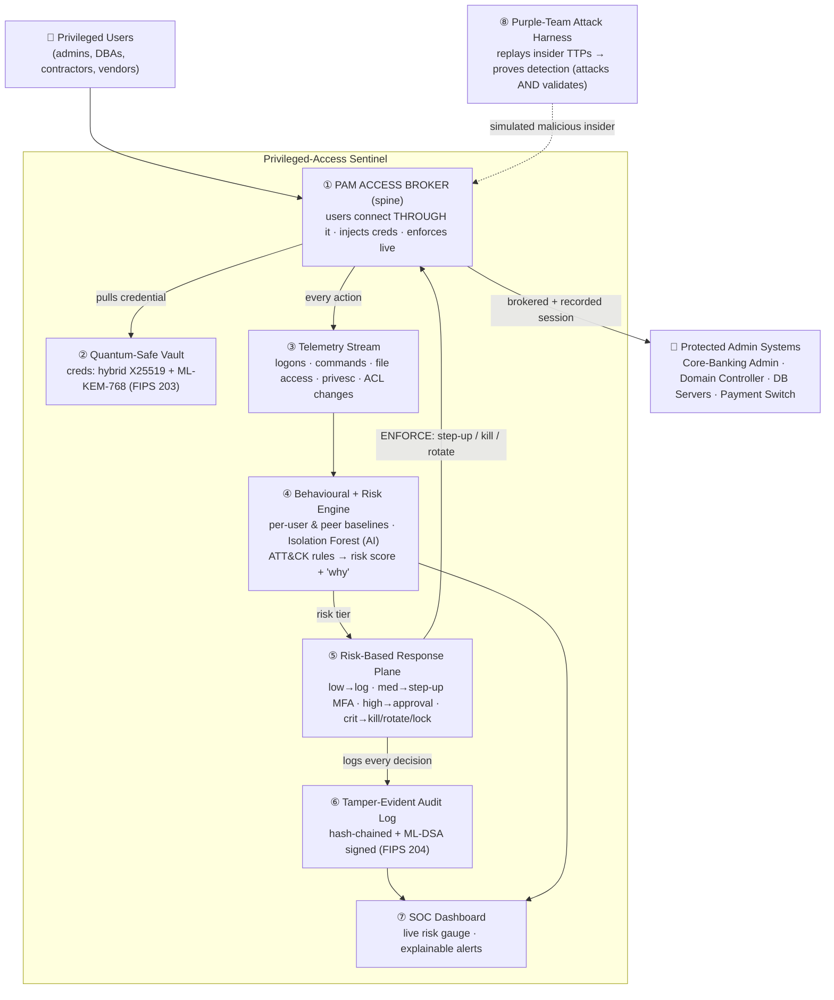

# FinSpark'26 · PS1 — Privileged-Access Sentinel · Architecture

**One-liner:** An *attack-validated* insider-threat control plane for privileged access — nobody
touches credentials directly; a smart guard watches every privileged action, gets stricter as risk
rises, and keeps a tamper-proof, quantum-safe logbook.

## System diagram

## Rubric coverage (PS1)

| # | Component | Covers (Outcome / Focus Area) |
|---|---|---|
| ① | PAM Access Broker | Protects admin systems · Privileged Access Management |
| ② | Quantum-Safe Vault | QPC for credentials · Quantum-Safe Security |
| ③ | Telemetry Stream | Real-time detection |
| ④ | Behavioural + Risk Engine | Detects privileged misuse · Insider Threat Detection · AI behavioural analysis · Behaviour Analytics |
| ⑤ | Risk-Based Response Plane | Risk-based access control · Risk-Based Authentication |
| ⑥ | Tamper-Evident Audit Log | QPC for sensitive artefacts · Quantum-Safe Security |
| ⑦ | SOC Dashboard | Explainability / real-time visibility |
| ⑧ | Purple-Team Harness | Differentiator — proves every detection works |

## Demo flow (the winning 90 seconds)
1. Contractor logs in at 2 AM from a new device → impossible-travel flag.
2. Bulk-dumps the customer table → exfiltration flag.
3. Creates a hidden admin account → persistence flag.
4. Risk gauge climbs live → step-up MFA forced → session **killed**.
5. Attacker tries to edit the audit log to hide tracks → ML-DSA signature breaks → **tamper detected**.

*Validated against the CMU CERT Insider Threat dataset (r4.2/r5.2) + live attack injection.*
